<!-- Variant C · Bento -->

<a href="https://tiyoouw.com"><picture><source media="(prefers-color-scheme: dark)" srcset="./assets/readme/bento-hello-dark.svg"><source media="(prefers-color-scheme: light)" srcset="./assets/readme/bento-hello-light.svg"></picture></a><a href="https://tiyoouw.com/about"><picture><source media="(prefers-color-scheme: dark)" srcset="./assets/readme/bento-now-dark.svg"><source media="(prefers-color-scheme: light)" srcset="./assets/readme/bento-now-light.svg">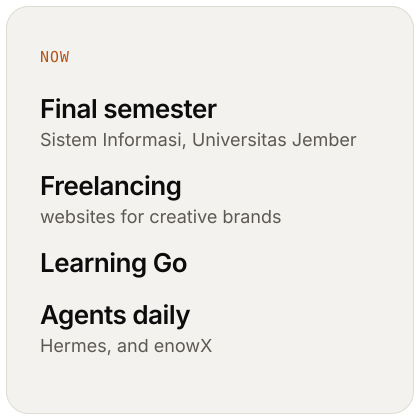</picture></a><a href="https://tiyoouw.com/work/kinetic-studiow">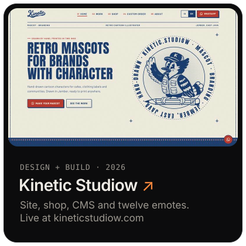</a><a href="https://tiyoouw.com/work/geofencing-inspections">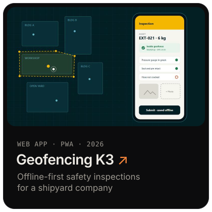</a><a href="https://github.com/Tiyouw"><picture><source media="(prefers-color-scheme: dark)" srcset="https://raw.githubusercontent.com/Tiyouw/Tiyouw/output/activity-graph-dark.svg"><source media="(prefers-color-scheme: light)" srcset="https://raw.githubusercontent.com/Tiyouw/Tiyouw/output/activity-graph-light.svg"></picture></a><a href="https://github.com/Tiyouw"><picture><source media="(prefers-color-scheme: dark)" srcset="https://raw.githubusercontent.com/Tiyouw/Tiyouw/output/activity-streaks-dark.svg"><source media="(prefers-color-scheme: light)" srcset="https://raw.githubusercontent.com/Tiyouw/Tiyouw/output/activity-streaks-light.svg">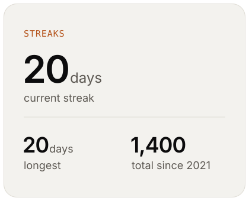</picture></a><a href="https://github.com/Tiyouw?tab=repositories"><picture><source media="(prefers-color-scheme: dark)" srcset="https://raw.githubusercontent.com/Tiyouw/Tiyouw/output/activity-counts-dark.svg"><source media="(prefers-color-scheme: light)" srcset="https://raw.githubusercontent.com/Tiyouw/Tiyouw/output/activity-counts-light.svg">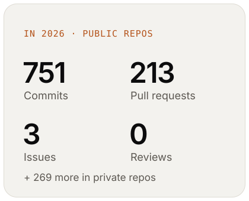</picture></a><a href="https://tiyoouw.com/services"><picture><source media="(prefers-color-scheme: dark)" srcset="./assets/readme/bento-flow-dark.svg"><source media="(prefers-color-scheme: light)" srcset="./assets/readme/bento-flow-light.svg"></picture></a><a href="https://github.com/Tiyouw?tab=repositories"><picture><source media="(prefers-color-scheme: dark)" srcset="https://raw.githubusercontent.com/Tiyouw/Tiyouw/output/activity-languages-dark.svg"><source media="(prefers-color-scheme: light)" srcset="https://raw.githubusercontent.com/Tiyouw/Tiyouw/output/activity-languages-light.svg">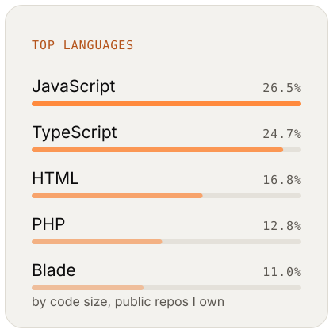</picture></a><a href="https://tiyoouw.com/work/himasif-space">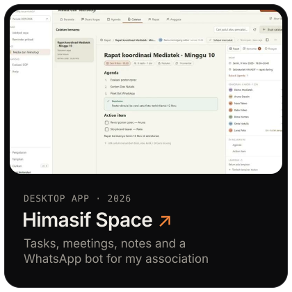</a><a href="https://tiyoouw.com/work/peta-budaya">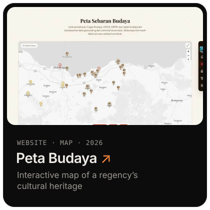</a><a href="https://tiyoouw.com/lab"><picture><source media="(prefers-color-scheme: dark)" srcset="./assets/readme/bento-next-dark.svg"><source media="(prefers-color-scheme: light)" srcset="./assets/readme/bento-next-light.svg">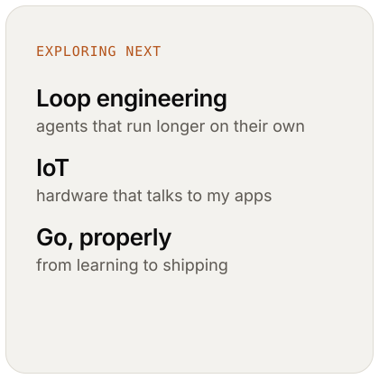</picture></a><a href="https://tiyoouw.com/about"><picture><source media="(prefers-color-scheme: dark)" srcset="./assets/readme/bento-stack-dark.svg"><source media="(prefers-color-scheme: light)" srcset="./assets/readme/bento-stack-light.svg">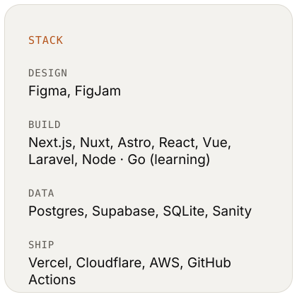</picture></a>

I like building apps and web apps that solve real problems, mostly for UMKM and people who need a website that actually fits them. No forced niche: design, code, motion, sound and video, and whatever the problem needs next.

**New work and offers, by email.** A few emails a year. [Subscribe on tiyoouw.com →](https://tiyoouw.com/#subscribe)

[Start a brief](https://tiyoouw.com/contact) · ahimsa@tiyoouw.com · [Instagram](https://www.instagram.com/tiyoouw/) · [WhatsApp](https://wa.me/6283186447999) · [LinkedIn](https://www.linkedin.com/in/ahimsajenar/) · [All work](https://tiyoouw.com/work)

Matur nuwun for stopping by · [Bahasa Indonesia](https://tiyoouw.com/id)
